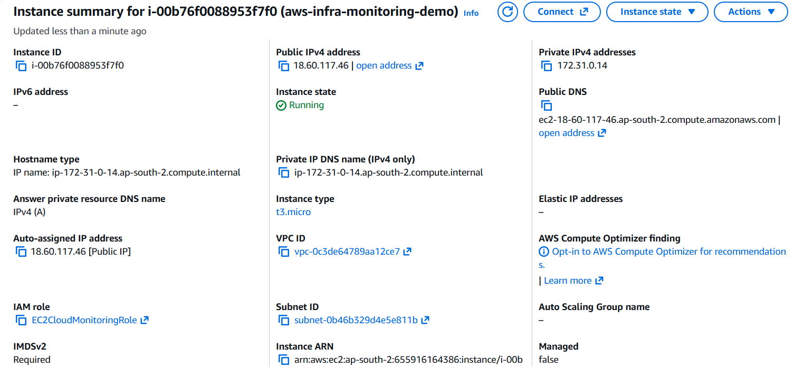
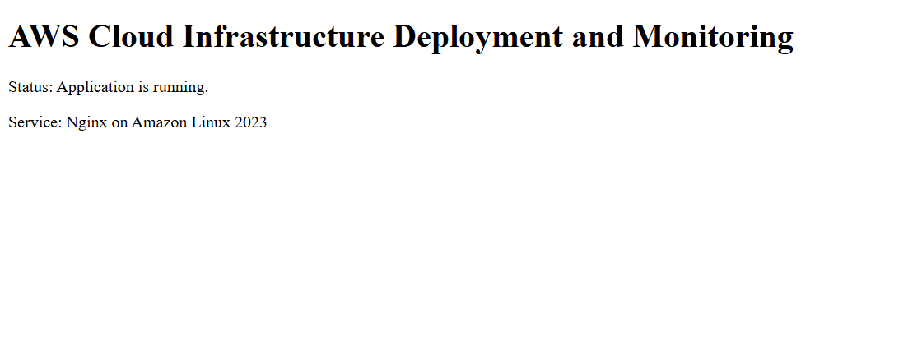
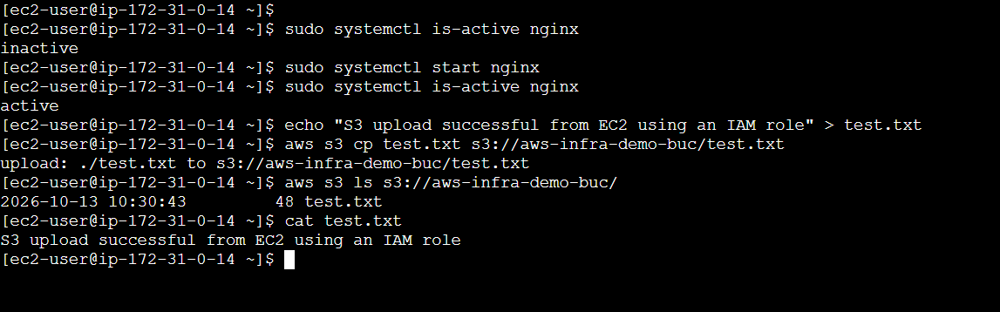
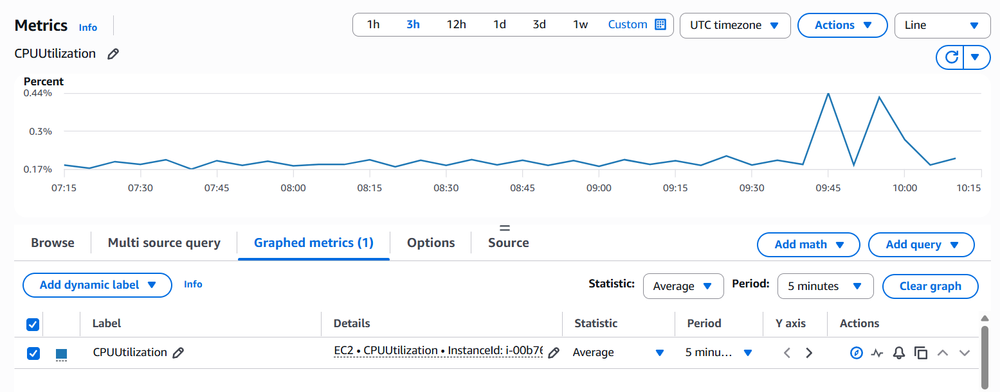
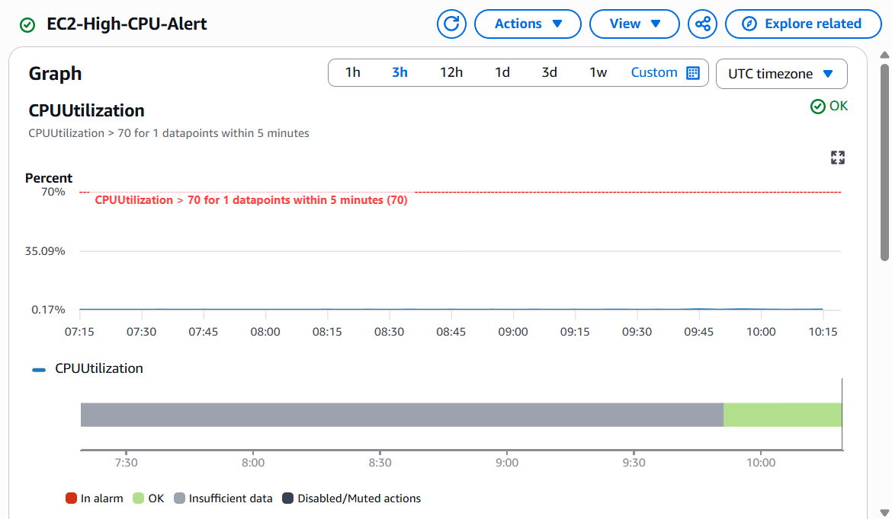

# AWS Cloud Infrastructure Deployment and Monitoring

A hands-on AWS infrastructure project demonstrating Linux web server deployment, IAM-based S3 access, CloudWatch monitoring, and basic infrastructure troubleshooting.

## Project Overview

This project deploys a Linux-based web server on Amazon EC2, serves a custom webpage using Nginx, uploads a test file to a private Amazon S3 bucket through an EC2 IAM role, and monitors infrastructure health using Amazon CloudWatch.

The objective is to apply foundational cloud infrastructure, networking, access management, monitoring, and Linux troubleshooting concepts in a practical AWS environment.

## Objectives

- Deploy a Linux EC2 instance inside an existing VPC and subnet.
- Configure a security group for HTTP access.
- Install and run Nginx on Amazon Linux 2023.
- Create an IAM role for EC2 with scoped S3 permissions.
- Upload and verify a file in a private S3 bucket without hardcoded AWS credentials.
- Monitor EC2 CPU utilization using CloudWatch.
- Configure an alarm for high CPU utilization.
- Document implementation steps, verification results, and troubleshooting procedures.

## Architecture

The project uses the existing default VPC in the AWS Asia Pacific (Hyderabad) region.

The browser accesses the Nginx webpage through the EC2 instance's public IPv4 address. The EC2 instance uses an attached IAM role to access the project S3 bucket. CloudWatch collects standard EC2 metrics and evaluates the configured CPU alarm.

See [Architecture Documentation](docs/architecture.md).


## AWS Services and Technologies

| Service or Technology | Purpose |
|---|---|
| Amazon VPC | Provides the network environment for EC2 |
| Amazon EC2 | Hosts the Linux web server |
| Amazon Linux 2023 | Operating system for the instance |
| Nginx | Serves the custom webpage |
| Security Groups | Controls inbound network traffic |
| AWS IAM | Provides role-based access to S3 |
| Amazon S3 | Stores the test file privately |
| Amazon CloudWatch | Displays EC2 metrics and evaluates an alarm |
| AWS CLI | Performs S3 operations from EC2 |
| Linux Shell | Used for administration and troubleshooting |
| Git and GitHub | Used for source control and project documentation |

## Implementation

### 1. Networking

- Used the existing default VPC.
- Selected an available default subnet in `ap-south-2`.
- Used the instance's public IPv4 address to access the webpage.
- Configured the security group to allow HTTP traffic on TCP port 80.

The existing VPC was reused to reduce setup time and avoid unnecessary networking resources.

### 2. EC2 Deployment

Launched an Amazon Linux 2023 EC2 instance named:

`aws-infra-monitoring-demo`

The instance runs Nginx and serves a custom HTML webpage.

The webpage displays:

- Project title
- Application status
- Web server information

### 3. IAM-Based S3 Access

Created the IAM role:

`EC2CloudMonitoringRole`

Created a scoped IAM policy named:

`EC2ProjectS3UploadPolicy`

The policy grants permission to list the project bucket and upload objects to it.

The instance uses the attached IAM role to obtain temporary AWS credentials rather than storing access keys on the server.

S3 bucket:

`aws-infra-demo-buc`

Test object:

`test.txt`

### 4. S3 Upload Verification

Created a test file on EC2:

```bash
echo "S3 upload successful from EC2 using an IAM role" > test.txt
```

Uploaded it to S3:

```bash
aws s3 cp test.txt s3://aws-infra-demo-buc/test.txt
```

Verified the object:

```bash
aws s3 ls s3://aws-infra-demo-buc/
```

Read the local file:

```bash
cat test.txt
```

The uploaded object was visible in the S3 listing, and the local file contents were verified.

### 5. CloudWatch Monitoring

Configured CloudWatch to monitor the EC2 `CPUUtilization` metric.

Alarm configuration:

| Setting | Value |
|---|---|
| Alarm name | `EC2-High-CPU-Alert` |
| Metric | `CPUUtilization` |
| Statistic | Average |
| Period | 5 minutes |
| Threshold | Greater than 70% |
| Notification action | Not configured |

The CPU utilization graph displayed metric data points. The alarm was subsequently observed in the `OK` state.

The alarm evaluates CPU utilization but does not send email notifications because no notification action was configured.

## Verification Results

| Component | Verification |
|---|---|
| EC2 | Instance observed in the Running state |
| Nginx | Custom webpage loaded through the public IPv4 address |
| IAM | Project role observed attached to EC2 |
| S3 | Test object upload and listing verified |
| CloudWatch Metrics | CPU utilization data points observed |
| CloudWatch Alarm | Alarm observed in the `OK` state |

These results reflect the implementation evidence collected during the project.

## Deployment Evidence

### EC2 Instance



### Nginx Webpage



### S3 Upload Verification



### CloudWatch CPU Metrics



### CloudWatch Alarm



## Troubleshooting

The troubleshooting documentation records the AWS CLI authentication error encountered during setup, implementation verification, and potential failure scenarios.

See [Troubleshooting Documentation](docs/troubleshooting.md).

The Linux health-check script is available at [scripts/health-check.sh](scripts/health-check.sh).

Only tests actually performed are recorded as completed. Pending tests and potential failure scenarios are identified separately.

## Security Considerations

- Used an EC2 IAM role for application access to S3.
- Avoided hardcoding AWS credentials on the EC2 instance.
- Scoped the project S3 policy to the specific bucket.
- Kept the S3 bucket private.
- Used HTTP-only inbound access for the public webpage.
- Did not intentionally expose SSH to the entire internet.
- Avoided unnecessary infrastructure services.

The public webpage uses HTTP rather than HTTPS and is intended only for demonstration purposes. It should not be used to transmit sensitive information.

## Limitations

- The existing default VPC was reused rather than building a custom network.
- The webpage is served over HTTP without TLS.
- The CloudWatch alarm has no configured email notification action.
- Monitoring is limited to standard EC2 metrics.
- No load balancer, auto scaling, or high-availability architecture was implemented.
- The health-check script requires execution and verification before it can be claimed as tested.

## Future Improvements

- Configure CloudWatch alarm notifications through Amazon SNS.
- Add HTTPS using an appropriate TLS termination solution.
- Implement infrastructure provisioning through Terraform.
- Extend monitoring to application and system-level metrics.
- Add structured logging and automated health checks.
- Introduce automated deployment and configuration management.

## Cleanup

After collecting the required evidence:

1. Terminate the EC2 instance if it is no longer needed.
2. Delete the S3 test object and bucket if they are no longer needed.
3. Remove unused project-specific IAM roles and policies.
4. Delete the CloudWatch alarm if it is no longer required.
5. Remove unnecessary IAM permissions and access keys.
6. Review AWS billing for remaining resources and charges.

Check for associated EBS volumes, snapshots, public IPv4 addresses, and other billable resources before considering cleanup complete.

## Author

**Abdul Raheem**

ECE Graduate | Cloud Infrastructure | DevOps | Linux | AWS