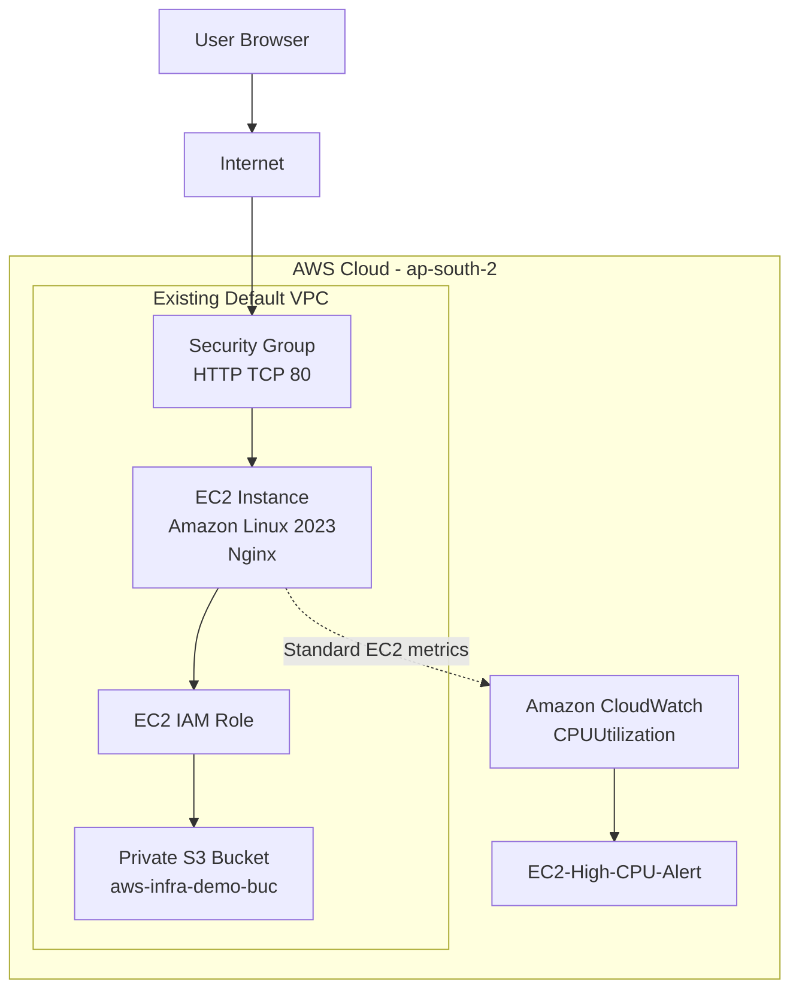

# AWS Infrastructure Architecture

## Overview

The project uses an existing default VPC in the AWS Asia Pacific (Hyderabad) region (`ap-south-2`).

An Amazon Linux 2023 EC2 instance runs Nginx and serves a custom webpage. An attached IAM role grants the instance scoped permissions to upload a test file to a private S3 bucket.

Amazon CloudWatch collects standard EC2 metrics and evaluates a CPU utilization alarm.

## Architecture Diagram

## Component Responsibilities

### Amazon VPC

Provides the network environment for the EC2 instance.

The project reused an existing default VPC and subnet instead of creating a separate custom network.

### Security Group

Controls inbound access to the EC2 instance.

The demonstration requires HTTP access on TCP port 80. SSH should not be exposed to unrestricted internet access.

### Amazon EC2

Runs Amazon Linux 2023 and hosts the Nginx web server.

The instance was launched as `aws-infra-monitoring-demo`.

### Nginx

Serves the custom HTML webpage and provides an HTTP endpoint for basic health verification.

### IAM Role

The `EC2CloudMonitoringRole` role is attached to the EC2 instance.

The role provides temporary credentials that the AWS CLI can use to access the permitted S3 resources.

### Amazon S3

The private bucket `aws-infra-demo-buc` stores the uploaded test object `test.txt`.

The bucket is intended to remain private, with public access blocked.

### Amazon CloudWatch

CloudWatch displays the EC2 CPU utilization metric and evaluates the `EC2-High-CPU-Alert` alarm.

The alarm threshold is greater than 70% average CPU utilization over a five-minute period.

No email notification action is configured.

## Request Flow

1. A user opens the EC2 public IPv4 address in a browser.
2. Internet traffic reaches the EC2 instance through its security group.
3. Nginx serves the webpage over HTTP.
4. The EC2 AWS CLI uses the attached IAM role to upload the test object to S3.
5. CloudWatch receives standard EC2 metrics and evaluates the CPU alarm.

## Security Boundaries

- The security group controls network access.
- The IAM role controls AWS API permissions.
- The S3 bucket should remain private.
- AWS credentials must not be committed to the repository.
- The public HTTP endpoint is for demonstration purposes only.

## Design Trade-Off

Reusing the default VPC reduced deployment time and configuration complexity.

A production architecture might instead use a custom VPC, carefully designed public and private subnets, HTTPS, centralized logging, and more extensive monitoring.